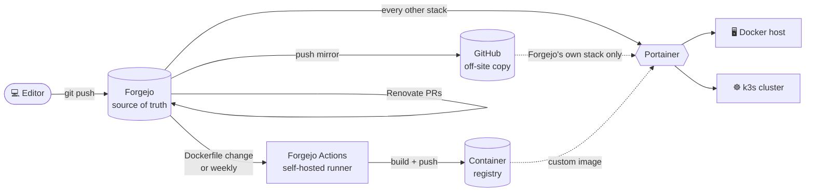
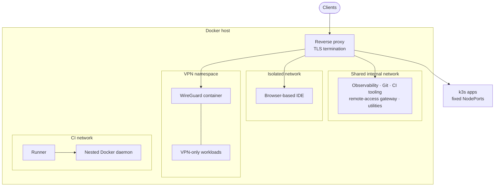

# 🏠 Homelab, run as GitOps

**A self-hosted platform where every service is defined in Git, built by my own CI, and kept current by a bot.**

> The configuration lives in a private repository. This page describes how the platform is designed and why. It deliberately leaves out hostnames, addresses, ports and versions.

---

## At a glance

- **Everything is code.** About a dozen Docker Compose stacks on one host, plus a few apps on a k3s cluster, all defined in one Git repository.
- **Self-hosted source of truth.** The repository lives on my own Forgejo server, which push-mirrors every commit to GitHub as an off-site backup.
- **Own CI.** A self-hosted Forgejo Actions runner builds and publishes a custom development-environment image on every Dockerfile change and weekly for security patches.
- **Automated dependency updates.** Renovate opens pull requests for image and CI-action updates, with rules that hold back risky upgrades for manual approval.
- **Observability.** Logs from the host, containers and network devices flow into Loki. Metrics flow into Prometheus. Grafana sits on top of both.
- **Secure by default.** No secrets in Git, almost no published ports, a single reverse proxy at the edge, and privilege-escalation protection on every container.

---

## How a change ships

1. **Commit.** Every change is a commit with a `<stack> - <what changed>` message. Before each commit, an AI reviewer (Claude Code) checks the diff against the repo's written conventions and runs `docker compose config` on any compose file it touched.
2. **Mirror.** Forgejo pushes the commit to GitHub within seconds.
3. **Build, if needed.** If the custom image's Dockerfile changed, the runner builds it and pushes it to the registry. A weekly scheduled run picks up base-image security fixes even when nothing changed.
4. **Deploy.** I redeploy the affected stack in Portainer, which pulls it from Git. Deploys are a deliberate manual step: `main` is always deployable, and I choose when each change goes live.

---

## Runtime layout

---

## Design decisions

### A Git server that can't take itself down
Portainer deploys almost everything from Forgejo. If Forgejo also deployed *itself*, one bad commit could break Forgejo, and then Portainer couldn't pull the fix. So Forgejo's own stack is the single exception: Portainer pulls it from the GitHub mirror. GitHub is still never edited directly, because the mirror force-pushes, so it holds exactly what Forgejo has. It just isn't Forgejo's own deploy source.

The same reasoning applies to Portainer: it can't redeploy itself, so it runs from a local file on the host and is updated by script.

### Internal paths for the deploy pipeline
Portainer and Renovate reach Forgejo over the internal container network, not through the public reverse proxy. If a bad commit broke the proxy, the pipeline that ships the fix still works.

### A self-hosted CI runner, isolated from the host
Moving off GitHub meant giving up GitHub's hosted runners, so I run my own. Its jobs run inside a **nested Docker daemon** rather than on the host's Docker. A build can't see or touch the production containers. The nested daemon is reachable only on its own private network, and its layer cache persists between runs, which keeps rebuilds fast. The cost is one privileged sidecar container. I accept that because the alternative, mounting the host's Docker socket, would give every job control over the whole host.

### Pin what holds state, float what doesn't
Stateless apps track `latest` and update on redeploy. Anything where an unplanned upgrade could corrupt data or take everything down is pinned to a version: the log/metrics stack, the reverse proxy, the VPN container, and the Git server and runner (pinned to a major line, since major Git-server upgrades migrate the database one way). A compatibility pin stays wherever an upstream app requires a specific version of a dependency.

### Renovate, tuned so updates are low-effort
- **Major upgrades of the Git server and runner** wait on a Dependency Dashboard checkbox, so they never open a PR by surprise.
- **CI-action updates are grouped into one PR**, because every merge to the workflow triggers an image build.
- **Images that ship together are grouped**, so a stack gets one PR and one redeploy.
- **Known-incompatible upgrades are disabled outright**, with the reason written in the config.
- Renovate runs hourly as an unprivileged bot user scoped to this one repository.

### VPN-only workloads that fail closed
Some containers must only reach the internet through a VPN. They share the network namespace of a WireGuard container, so they have no network path of their own to leak through. They start only after the tunnel's healthcheck passes, and their web UIs are reachable only via the reverse proxy, through the tunnel container.

### Kubernetes manifests that stay predictable
Each app is one self-contained file (Namespace, Deployment, Service). Services use fixed NodePorts, so the reverse proxy's targets never move, and stateful apps use k3s `local-path` storage.

---

## Security posture

| Area | Approach |
|---|---|
| **Secrets** | Never committed. Compose files use `${VAR}` placeholders filled from Portainer's per-stack environment, and `.env` files are gitignored. CI credentials are Forgejo Actions secrets. |
| **Exposure** | One reverse proxy terminates TLS for everything. Services publish no host ports unless something outside the network genuinely needs one, and the proxy's own admin UI is bound to localhost. |
| **Segmentation** | The browser IDE sits on its own network shared only with the proxy. CI runs on its own network. VPN workloads live inside the tunnel's namespace. |
| **Container hardening** | `no-new-privileges` on every container, with exceptions documented one by one. Non-root users and rootless images where the app supports them. |
| **Persistent data** | Bind mounts in one predictable host directory per stack, never anonymous volumes, so backups and permissions are easy to reason about. |
| **Supply chain** | CI actions are referenced by explicit source URL. Image and action updates arrive as reviewable PRs, not silent pulls. |

---

## Observability

- **Grafana Alloy** collects host logs, container logs, syslog from network devices, and audit logs from a secrets manager, and ships them to **Loki**.
- **Prometheus** with **node-exporter** covers host metrics.
- **Grafana** is the single pane for both.

---

## How I use AI in this project

I work with an AI assistant (Claude Code) as a reviewer and pair. It speeds up the work. It doesn't replace knowing what the system does, so the boundaries are explicit.

**What it does**
- **Reviews every diff** against the repo's written conventions (networking, storage, identity, hardening, tagging) and flags anything that breaks them.
- **Validates** every compose file it touches with `docker compose config` before a commit.
- **Drafts** config changes and documentation, and researches upstream docs when something new is being set up.
- **Audits.** For example, it scanned the full Git history for leaked credentials before I decided how much of this project to make public.

**What it never gets**
- **Secrets.** Tokens and passwords live in Portainer, Forgejo and files on the host. I enter them myself, never in the chat. Where the assistant has push access to Git, it's through a login I set up, not a token it was shown.
- **The host.** Its environment can't reach the host's Docker daemon or data directories, so it can't deploy, restart or inspect a running service.

**What I always decide**
- **Design.** It lays out options and trade-offs; I choose. For example, when the move off GitHub left CI without hosted runners, at one point it recommended keeping builds on GitHub Actions via the mirror, since that already worked. I chose a self-hosted runner instead, so GitHub stays a backup and nothing depends on it.
- **Every commit.** Nothing is committed or pushed without my go-ahead.
- **Every deploy.** Redeploying in Portainer is a manual step I take, so no change reaches the host on the AI's say-so.

The conventions file that guides the reviews is the same one I'd hand a new teammate. Writing it down is what made the reviews consistent.

---

## Lessons learned

- **Bootstrap loops are real.** Anything that deploys infrastructure needs a path that doesn't depend on that infrastructure. That's what drove both the GitHub fallback for the Git server and the internal URLs for the deploy pipeline.
- **"Free" CI was a hidden dependency.** On GitHub, hosted runners just exist. Self-hosting made me decide what a build is allowed to touch, and the answer was "not the host".
- **Rootless images and custom UIDs need care.** Running containers as a fixed host UID with no passwd entry inside the image breaks apps that look up their own username. The fix is small (an environment variable), but you have to find it first.
- **Write the conventions down.** A short conventions file (network, storage, identity, hardening, tagging) turned "does this look right?" into a checklist that humans and AI reviewers can both apply to every diff.

---

Designed, built and maintained by Stephen · reviewed with Claude Code 🤖

